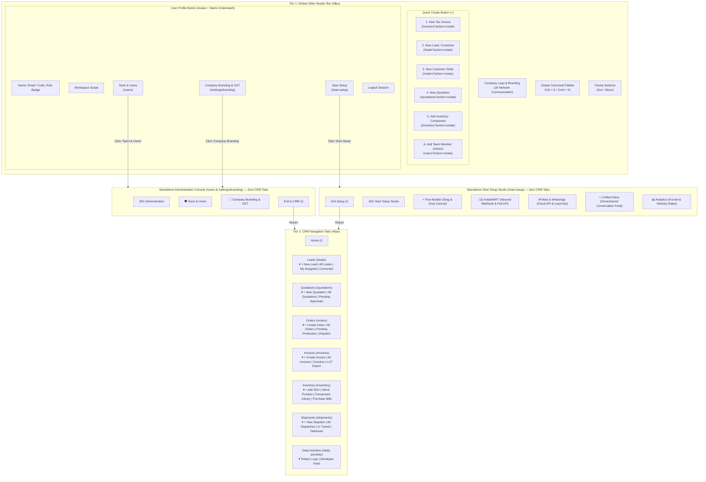

# UI Button & Navigation Arrangement Architecture Specification
**JS Network Communication CRM — Locked UI Hierarchy & Layout Blueprint**
*Document Version: 1.0.0 | Date: 2026-10-16 | Status: PERMANENT SPECIFICATION (DO NOT ALTER)*

---

## 1. Golden Rules & Architectural Invariants

> **Zero Modification Rule**: The layout structure, button placements, quick-create actions, and navigation items defined in this document are **permanently locked**. No automated tool, developer, or subagent may remove, reorder, or replace any button in the `+` Quick Create menu, the Tier 2 navigation tabs, or the User profile menu.

> **Start Setup Page Isolation Rule**: The **Start Setup Studio** (`/start-setup`) is an independent, distraction-free configuration console. It is rendered **completely outside `AppLayout`** so that none of the standard CRM navigation tabs (Home, Leads, Quotations, Orders, Invoices, Inventory, Shipments) are displayed on that page. It has its own dedicated header with `← Back to CRM`.

---

## 2. Complete Button & Navigation Hierarchy Map

---

## 3. Detailed Component Breakdown

### A. Global Header Bar (Tier 1 — Top 48px)
| Element | Visual Appearance | Function / Route | Target State / Modal |
| :--- | :--- | :--- | :--- |
| **Brand Logo & Name** | JNC Logo + Company Display Name | Organization identity | Displays active company branding |
| **Global Search** | Input bar with `Ctrl + K` badge | Fast search / command palette | Real-time dropdown jump list to any CRM module |
| **Quick Actions `(+)`** | Rounded CRM Blue `+` button | Drops down 6 quick-action buttons | Opens creation drawer / form on target page |
| **Theme Toggle** | Sun (Amber) / Moon (Indigo) | Switches Dark & Light theme | Updates CSS theme across entire application |
| **User Profile Button** | Circular avatar with **User Name underneath** | Drops down user session menu | Displays profile card, branding link, setup, and logout |

#### Quick Actions `(+)` Dropdown Items:
1. **New Tax Invoice** (`Receipt` icon, Emerald green) &rarr; `/invoices?action=create`
2. **New Lead / Customer** (`Users` icon, CRM Blue) &rarr; `/leads?action=create`
3. **New Customer Order** (`ShoppingCart` icon, Amber) &rarr; `/orders?action=create`
4. **New Quotation** (`FileText` icon, Indigo) &rarr; `/quotations?action=create`
5. **Add Inventory Component** (`Package` icon, Purple) &rarr; `/inventory?action=create`
6. **Add Team Member** (`UserPlus` icon, Blue, Admin only) &rarr; `/users?action=create`

---

### B. Tier 2 CRM Navigation Bar (40px)
Every tab has a direct click target, plus a dropdown caret (`▾`) exposing sub-options:

| # | Tab Label | Direct Route | Dropdown Sub-Items |
| :---: | :--- | :--- | :--- |
| **1** | **Home** | `/` | *None (Direct Dashboard view)* |
| **2** | **Leads** | `/leads` | &bull; `+ New Lead` (`/leads?action=create`) &bull; `All Leads` (`/leads`) &bull; `My Assigned Leads` (`/leads?filter=my`) &bull; `Converted Pipeline` (`/leads?filter=converted`) |
| **3** | **Quotations** | `/quotations` | &bull; `+ New Quotation` (`/quotations?action=create`) &bull; `All Quotations` (`/quotations`) &bull; `Pending Approvals` (`/quotations?filter=pending`) |
| **4** | **Orders** | `/orders` | &bull; `+ Create Order` (`/orders?action=create`) &bull; `All Orders` (`/orders`) &bull; `Pending Production` (`/orders?filter=pending`) &bull; `Ready for Dispatch` (`/orders?filter=ready`) |
| **5** | **Invoices** | `/invoices` | &bull; `+ Create Tax Invoice / Document` (`/invoices?action=create`) &bull; `All Invoices` (`/invoices`) &bull; `Unpaid & Overdue` (`/invoices?filter=unpaid`) &bull; `LUT / Export Documents` (`/invoices?filter=lut`) |
| **6** | **Inventory** | `/inventory` | &bull; `+ Add Component / SKU` (`/inventory?action=create`) &bull; `Project Stock Position` (`/inventory?tab=stock`) &bull; `Component Library` (`/inventory?tab=library`) &bull; `Purchase Bills Hub` (`/inventory?tab=bills`) |
| **7** | **Shipments** | `/shipments` | &bull; `+ New Dispatch` (`/shipments?action=create`) &bull; `All Dispatches` (`/shipments`) &bull; `In Transit` (`/shipments?filter=transit`) &bull; `Delivered` (`/shipments?filter=delivered`) |
| **8** | **Daily Activities** | `/daily-activities` | &bull; `Today's Task Logs` (`/daily-activities`) &bull; `Developer Activity Feed` (`/daily-activities?filter=dev`) |

> Note: **Team & Users** (`/users`), **Company Branding & GST** (`/settings/branding`), and **Start Setup** (`/start-setup`) are placed under the **User Profile Button** (top right avatar with user name underneath).

---

### C. Standalone Start Setup Studio (`/start-setup`)
> **Pure Setup Experience**: This page is completely isolated from the standard CRM layout. There is **NO** Tier 1 CRM search or quick-create bar, and **NO** Tier 2 navigation tabs (Home, Quotation, Invoices, Orders, etc.).

#### Top Header Elements:
1. **Company Logo & Title**: `JS Network Communication — Start Setup Studio`.
2. **Module Switcher Tabs**:
   - ⚡ **Flow Builder**: Interactive drag-and-drop node canvas with Bezier curves, dynamic connection ports, 7 node types (`START`, `SEND_WHATSAPP`, `SEND_EMAIL`, `SEND_SMS`, `WAIT`, `CONDITION`, `EXIT`), node palette, property inspector, and live simulation tester.
   - 🇮🇳 **IndiaMART**: Real-time push webhook ingestion (`/api/v1/webhooks/indiamart`), `x-indiamart-token` credential manager, pull sync API trigger, and seller integration guide.
   - 🌐 **Meta & WhatsApp**: Facebook Lead Ads webhook URL, WhatsApp Cloud API phone number ID, WABA ID, and permanent bearer token manager.
   - 💬 **Unified Inbox**: Real-time multi-channel inbox conversation feed, active sequence step status, and direct customer message composer.
   - 📊 **Analytics**: Multi-channel lead drop-off funnel, channel delivery & response rates, and conversion KPI cards.
4. **Theme Switcher**: Independent dark / light toggle.
5. **`Exit Setup` Button**: Alternate return button to the main CRM workspace.

---

## 4. Protected Code File Registry

The following codebase files enforce and implement this layout structure:
- `apps/web/src/components/layout/Navbar.tsx`: Implements Tier 1 Global Header and Tier 2 App Tabs.
- `apps/web/src/pages/StartSetupPage.tsx`: Implements the standalone Start Setup Studio.
- `apps/web/src/App.tsx`: Enforces that `/start-setup` is routed **outside** `AppLayout`.
- `apps/web/src/components/flow-studio/*`: Contains all 5 Start Setup Studio sub-modules.
